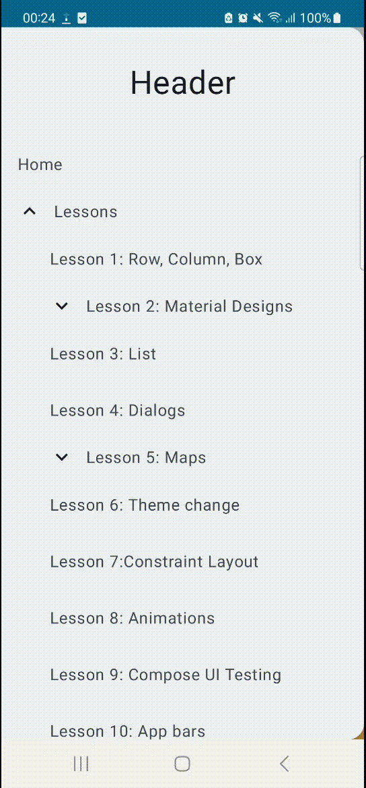
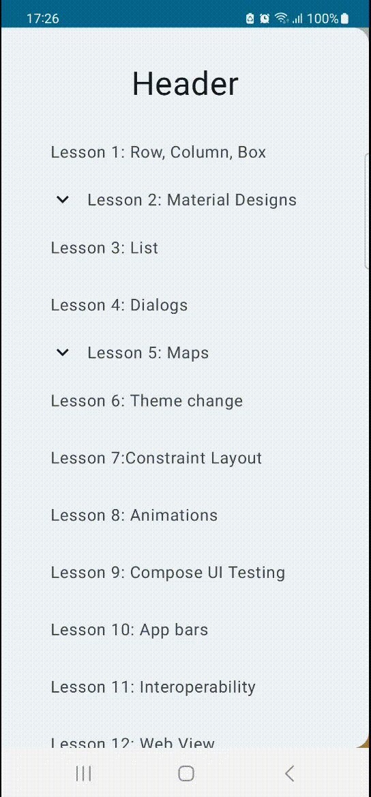
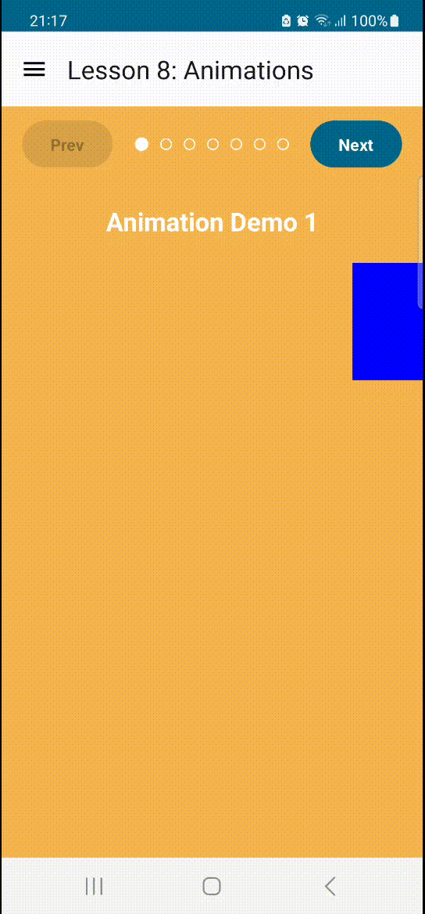
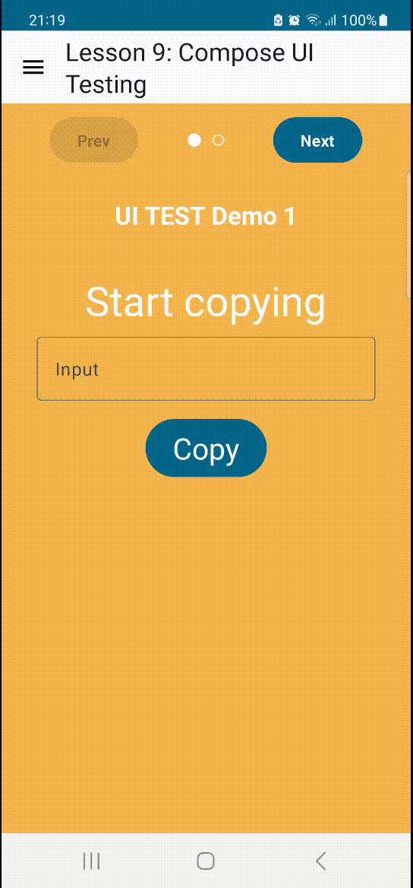
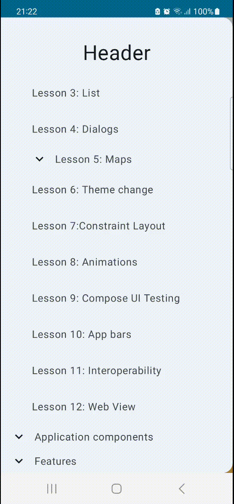
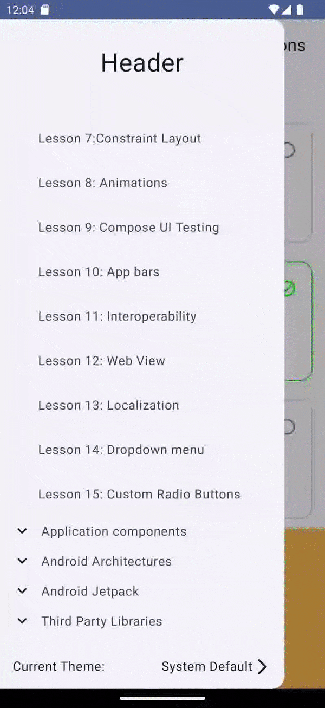

# Jetpack Compose All-in-One Guide

[](https://kotlinlang.org/)
[](https://developer.android.com/build)
[](https://developer.android.com/develop/ui/compose/bom)
[](LICENSE)


An open-source collection of small, focused Android examples for learning Jetpack Compose—from core layouts and state to architecture, maps, persistence, networking, and complete UI demos. Browse the lessons independently or use the project as a reference while building your own Compose apps.

## What you can explore

| Area | Topics included |
| --- | --- |
| Compose fundamentals | `Column`, `Row`, `Box`, modifiers, state, visibility, themes, tabs, dialogs, lists, flow layouts, animations, and ConstraintLayout |
| Android platform | Activities, services, broadcast receivers, content providers, permissions, CameraX, ML Kit barcode scanning, biometrics, and media playback |
| Architecture | MVP, MVVM, MVI, Clean Architecture, Hilt, ViewModel, LiveData, Room, WorkManager, Paging, DataStore, and testing |
| Integrations | Retrofit, Moshi, Gson, RxJava, Firebase, Google Maps and Places, Stripe, Apollo GraphQL, Coil, Glide, Lottie, and WebView |
| UI demos | Instagram, TikTok, WhatsApp, quotes, weather, currency conversion, news, polls, and more |

## Requirements

- Android Studio with Android SDK Platform 37 installed
- JDK 17
- Gradle 9.6 (provided by the wrapper)
- Android Gradle Plugin 9.4.0

The project uses AGP's built-in Kotlin support, Kotlin 2.4.20 for the Compose compiler plugin, and the Compose BOM `2026.09.00`. The BOM keeps all Compose UI dependencies aligned; individual Compose dependencies intentionally have no version numbers.

## Getting started

1. Clone the repository:

   ```bash
   git clone https://github.com/myofficework000/Jetpack-Compose-All-in-one-Guide.git
   cd Jetpack-Compose-All-in-one-Guide
   ```

2. Open the project in Android Studio and allow the Gradle sync to complete.

3. Optional: create a `local.properties` file for features that need your own credentials. The project still syncs without this file; those features receive empty placeholder values.

   ```properties
   GOOGLE_MAPS_API_KEY=your_google_maps_api_key
   STRIPE_BACKEND_BASEURL=https://your-secure-backend.example
   ```

   Never commit credentials. Restrict any Google Maps key to this app's package name and signing certificate, and keep Stripe secret keys on your backend—not in the Android app.

4. Run the `app` configuration on an emulator or physical device running Android 10 (API 29) or newer.

### Command line

```bash
./gradlew :app:assembleDebug
./gradlew :app:testDebugUnitTest
```

On Windows, use `gradlew.bat` instead. The first build downloads the Gradle distribution and dependencies.

## Project layout

```text
app/src/main/java/com/example/jetpack_compose_all_in_one/
├── lessons/                 # Incremental Compose lessons
├── android_architectures/   # MVP, MVVM, MVI, and Clean Architecture examples
├── jetpack_components/      # Room, WorkManager, Paging, Navigation, and more
├── third_party_lib/         # API, Maps, Stripe, GraphQL, Firebase integrations
├── demos/                   # End-to-end UI and feature demos
└── ui/                      # App entry points, shared views, and theme
```

## Lesson gallery

Each lesson below is available from the in-app menu. Preview GIFs are included wherever the repository has a captured walkthrough.

| Lesson | What it covers | Preview |
| --- | --- | --- |
| 1. Column, Row, Box, Modifier | Core Compose layouts, alignment, and modifiers. |  |
| 2. Material Design | Shapes, surfaces, text, buttons, images, progress indicators, and floating action buttons. |  |
| 3. Lists | Vertical and horizontal lists, grids, expandable lists, animated lists, and shimmer. |  |
| 4. Dialogs | Alert, bottom-sheet, app-rating, and logout dialogs. |  |
| 5. Maps | Map basics, markers, map types, current location, and search. Requires a Google Maps key. |  |
| 6. Theme change | Switching between light and dark themes. |  |
| 7. ConstraintLayout | ConstraintLayout basics, guidelines, chains, barriers, and a complex music UI. |  |
| 8. Animation | Tween, animated visibility/content, animation specs, and shimmer. |  |
| 9. UI testing | Compose UI-testing examples. |  |
| 10. Theming | Custom colors, typography, shapes, and themes. | Source available; walkthrough capture pending. |
| 11. XML interoperability | Using a Compose view inside a conventional XML activity layout. |  |
| 12. WebView | Displaying web content from Compose. |  |
| 13. Localization | Language support, dates/numbers, RTL, and plurals. | Source available; walkthrough capture pending. |
| 14. Drop-down menu | Compose drop-down menu patterns. | Source available; walkthrough capture pending. |
| 15. Custom radio button | Radio-button customization. |  |
| 16. State and visibility | State-driven UI and visibility. | Source available; walkthrough capture pending. |
| 17. Flow layouts | `FlowRow` and `FlowColumn`. | Source available; walkthrough capture pending. |
| 18. UI testing | Additional UI-testing examples. | Source available; walkthrough capture pending. |
| 19. OkHttp caching | Caching Retrofit responses with OkHttp interceptors. | Source available; walkthrough capture pending. |
| 20. Biometric authentication | Biometric authentication flow. | Source available; walkthrough capture pending. |
| 21. DataStore | DataStore preferences. | Source available; walkthrough capture pending. |
| 22. Media3 ExoPlayer | Media playback with Media3. | Source available; walkthrough capture pending. |
| 23. Tabs | `TabRow`, custom indicators, selection, and Scaffold integration. | Source available; walkthrough capture pending. |

## Demo gallery

The repository also includes the following runnable demo screens. Use the in-app menu to launch them.

| Demo group | Screens |
| --- | --- |
| Social and media UI | Instagram, Twitter, Gmail, YouTube, Spotify, TikTok, Facebook, Music UI, and Media3 playback |
| App concepts | Crypto app (MVVM), Movies app (MVVM), Dating app, Paint, Meditation, Polls, Quiz, and Thread demo |
| API and data | Currency converter, GitHub API, History of Day, News app, Swipe News, Random Fox, and Firestore Notes |
| Device features | Barcode scanner, Camera2, and Horizontal Pager |
| Third-party integration | [Stripe integration walkthrough](demo/third_party-stripe.mp4), Google Maps, GraphQL, Firebase, and ML Kit |

The demo source lives under [`app/src/main/java/com/example/jetpack_compose_all_in_one/demos`](app/src/main/java/com/example/jetpack_compose_all_in_one/demos). Additional captured demo screenshots are welcome in `demo/`; the gallery above preserves every existing lesson preview rather than replacing unavailable captures with generated artwork.

## Contributing

Contributions are welcome. Please open an issue to discuss a substantial change, then submit a focused pull request with a clear description and appropriate tests where practical.

When adding a Compose dependency, prefer the existing BOM unless the library is intentionally versioned independently. Keep credentials and generated files out of commits.

## License

This project is licensed under the [MIT License](LICENSE).

## Author and apps

- [LinkedIn](https://www.linkedin.com/in/myofficework/)
- [Medium](https://medium.com/@myofficework000)
- [Instagram](https://www.instagram.com/kumarpathakabhishek/)
- [Email](mailto:myofficework000@gmail.com)

Apps built with Jetpack Compose:

- [Tetris](https://play.google.com/store/apps/details?id=com.abhishekpathak.tetris)
- [Business](https://play.google.com/store/apps/details?id=abhishek.pathak.business)
- [Money Minder](https://play.google.com/store/apps/details?id=com.business.money_minder)
- [QuickTask](https://play.google.com/store/apps/details?id=com.codegalaxy.quicktask)
